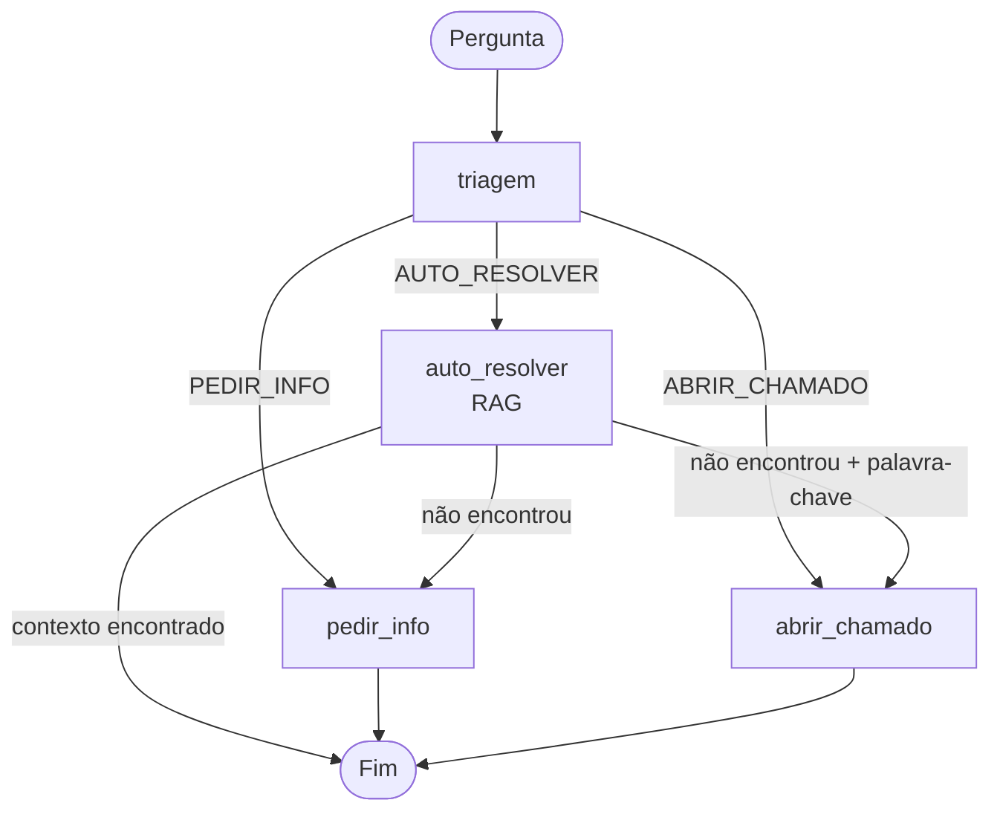
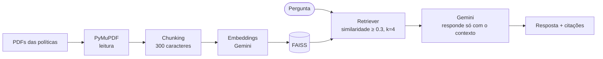

# Agente de IA para Triagem de Service Desk com RAG e LangGraph

Agente que atende dúvidas sobre **políticas internas** de uma empresa e decide, para cada mensagem, o melhor caminho: **responder automaticamente**, **pedir mais informações** ou **abrir um chamado**. As respostas usam **RAG** e vêm com **citação de documento e página**. Quando não há base nos documentos, o agente diz **"Não sei"** em vez de inventar.

Desenvolvido durante a **Imersão Dev Agentes de IA (Alura + Google Gemini)**.

## O que o agente faz

| Caminho | Quando acontece | O que o agente faz | Exemplo |
|---|---|---|---|
| `AUTO_RESOLVER` | pergunta clara, coberta pelas políticas | responde com RAG e cita documento e página | "Posso reembolsar a internet?" |
| `PEDIR_INFO` | mensagem vaga ou fora do tema | pede os detalhes que faltam | "Quantas capivaras tem no parque?" |
| `ABRIR_CHAMADO` | pedido de exceção, liberação ou aprovação | abre um chamado com a urgência identificada | "Quero mais 5 dias de trabalho remoto." |

Se a triagem escolhe `AUTO_RESOLVER` mas o RAG **não encontra resposta** nos documentos, o agente não inventa nada: abre um chamado (se a pergunta tiver palavras de exceção ou aprovação) ou pede mais informações. Esse é o *fallback* do grafo.

## Arquitetura



**Pipeline de RAG** (nó `auto_resolver`):



## Decisões de projeto

- **Saída estruturada com Pydantic:** a decisão da triagem (`decisao`, `urgencia`, `campos_faltantes`) chega como JSON validado por um schema com `Literal`, e não como texto livre que precisaria ser interpretado.
- **`temperature=0`:** respostas mais estáveis, ideais para classificação e para respostas que devem seguir os documentos.
- **Respostas só com base nos documentos:** o prompt do RAG manda responder apenas com o contexto recuperado ou dizer "Não sei". O retriever também descarta trechos com similaridade baixa, e, se nenhum passa do limiar, o modelo nem é chamado.
- **Citações:** cada resposta traz documento, página e o trecho de origem, o que reduz alucinações e dá rastreabilidade.
- **Orquestração com LangGraph:** o fluxo é um grafo de estados com arestas condicionais, o que deixa explícitos o caminho de cada pergunta e os *fallbacks*.

## Tecnologias

- **LangChain** e **Gemini** (`gemini-2.5-flash` para o LLM e `gemini-embedding-001` para os embeddings)
- **Pydantic** (saída estruturada)
- **PyMuPDF** (leitura de PDFs), **FAISS** (busca por similaridade)
- **LangGraph** (orquestração)

## Como executar

1. Obtenha uma chave da API do Gemini no [Google AI Studio](https://aistudio.google.com/).
2. Guarde a chave como `GEMINI_API_KEY`:
   - **Google Colab:** painel *Secrets* (ícone de chave), com o nome `GEMINI_API_KEY`.
   - **Local:** variável de ambiente `GEMINI_API_KEY`.
3. Se for rodar localmente, instale as dependências (opcional, pois o notebook também instala):
   ```
   pip install -r requirements.txt
   ```
4. Abra `agente_triagem_service_desk.ipynb` e execute as células em ordem. No Colab, envie antes a pasta `politicas/` para o ambiente.

> **Nunca coloque a chave da API no código nem em arquivos enviados ao GitHub.**

## Estrutura do repositório

```
├── agente_triagem_service_desk.ipynb   # notebook completo, comentado
├── politicas/                          # PDFs de exemplo (fictícios)
│   ├── Política de Home Office.pdf
│   ├── Política de Reembolsos (Viagens e Despesas).pdf
│   └── Política de Uso de E-mail e Segurança da Informação.pdf
├── requirements.txt
├── .gitignore
├── LICENSE
└── README.md
```

## Sobre os dados

Os três PDFs em `politicas/` são **fictícios**, criados para este repositório. "Carraro Desenvolvimento" é o nome de empresa usado no exercício do curso e pode ser trocado na constante `EMPRESA` do notebook. Para usar o agente com políticas reais, substitua os PDFs da pasta.

## Limitações e próximos passos

- **Fallback por palavras-chave:** a lista `KEYWORD_ABRIR_TICKET` é uma regra simples. Uma alternativa é deixar o modelo decidir, ou combinar as duas abordagens.
- **Sem avaliação formal:** os testes são poucos e manuais. O próximo passo é montar um conjunto de perguntas com respostas esperadas e medir o acerto da triagem, a qualidade do RAG e a taxa de "Não sei".
- **Parâmetros do RAG ajustados à mão:** tamanho dos trechos, `k` e o limiar de similaridade (0.3) podem ser calibrados com esse conjunto.
- **Chamado simulado:** o nó `abrir_chamado` só gera um texto. Em produção, ele chamaria a API de uma ferramenta de chamados.
- **Sem memória de conversa:** cada pergunta é tratada isoladamente. O LangGraph permite acrescentar memória e aprovação humana antes de abrir o chamado.

## Autor

**Pedro Dorighello Bertuzzi** — Engenharia da Computação, FACAMP.
[LinkedIn](https://www.linkedin.com/in/pedrodbertuzzi/) · [GitHub](https://github.com/b3rtuzz1)

## Licença

[MIT](LICENSE)
